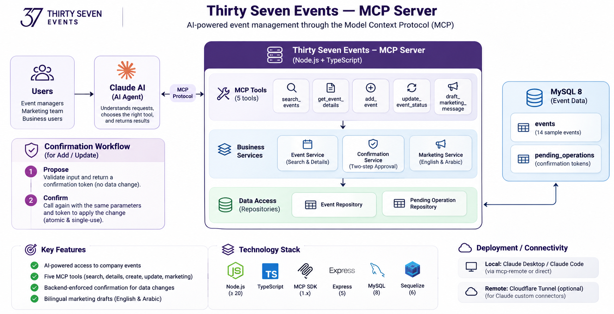
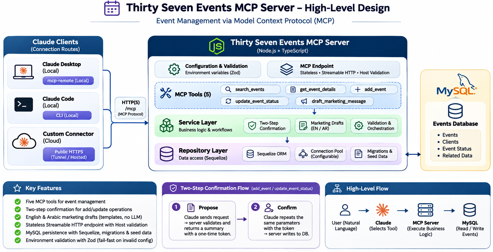

# Thirty Seven Events MCP Server

## Overview

An MCP (Model Context Protocol) server for Thirty Seven (37 Events), an events management and marketing company in Saudi Arabia. It lets an MCP client such as Claude search, read, create and update events stored in MySQL, and draft English and Arabic marketing copy for them. Creating an event or changing its status always requires an explicit confirmation, which the backend enforces.

The server exposes one endpoint, `/mcp` (Streamable HTTP). It has no REST API or web interface, and it does not call any AI provider: the AI is the MCP client that connects to it.

## Key Features

- **Five MCP tools:** search events, get event details, add an event, update an event's status, and draft marketing messages.
- **Backend-enforced confirmation:** `add_event` and `update_event_status` are two-step operations. The first call stores a proposal and writes nothing; the second call must repeat the exact parameters with the returned single-use, expiring token.
- **English and Arabic marketing drafts:** Instagram posts and emails built from stored event data with deterministic templates. No LLM is called.
- **Stateless Streamable HTTP endpoint** using the official MCP TypeScript SDK, with `Host` header validation.
- **MySQL persistence** through Sequelize, with migrations, sample seed data and a configurable connection pool.
- **Validated configuration:** environment variables are checked with Zod at startup, and an invalid value stops the process with a message naming the variable.

## Architecture Overview

This diagram illustrates how users interact with Claude,
how Claude communicates with the MCP server, and how
the server accesses event data.



## Internal Component Design

This diagram illustrates the internal server components,
including configuration validation, MCP tools, business
services, repository patterns, and database connectivity.



An MCP client sends a JSON-RPC request to `/mcp`. A tool module validates the arguments and calls a service. The service applies the business rules and uses repositories to read or write MySQL. The result, or a domain error, is returned as an MCP tool result.

| Layer                 | Responsibility                                                                                                                                      | Location                                                                           |
| --------------------- | --------------------------------------------------------------------------------------------------------------------------------------------------- | ---------------------------------------------------------------------------------- |
| Configuration         | Validates environment variables, creates the Sequelize connection and pool, and holds the MCP tool metadata and message text                        | `src/config/`                                                                      |
| MCP server            | Creates an `McpServer` per request and serves `/mcp` over stateless Streamable HTTP with `Host` header validation. Express hosts only this endpoint | `src/mcp/mcp-server.ts`, `src/mcp/mcp-transport.ts`, `src/app.ts`, `src/server.ts` |
| Tool registration     | One module per tool: validates input, calls a service, and converts results and errors into MCP tool results                                        | `src/mcp/tools/`, `src/mcp/tool-result.ts`                                         |
| Services              | Business rules: search and details, add and update with confirmation, token issuing and consumption, marketing drafts                               | `src/modules/events/`, `src/modules/confirmation/`, `src/modules/marketing/`       |
| Repositories          | Sequelize queries, transaction-aware                                                                                                                | `event.repository.ts`, `confirmation.repository.ts`                                |
| Database connection   | MySQL connection and pool, models, migrations, seeders, transaction runner                                                                          | `src/config/database.ts`, `src/database/`                                          |
| External integrations | None. MySQL is the only external system; no AI provider or third-party API is called                                                                | n/a                                                                                |

`src/container.ts` is the composition root that wires repositories and services together, and `src/bootstrap.ts` handles HTTP startup and graceful shutdown.

## Technology Stack

| Area                 | Technology                                                 |
| -------------------- | ---------------------------------------------------------- |
| Runtime and language | Node.js 20+, TypeScript                                    |
| MCP                  | `@modelcontextprotocol/sdk` 1.x, Streamable HTTP transport |
| HTTP hosting         | Express 5 (hosts the `/mcp` endpoint only)                 |
| Database             | MySQL 8                                                    |
| ORM and migrations   | Sequelize 6, `sequelize-cli`                               |
| Validation           | Zod                                                        |
| Testing              | Jest with SWC                                              |

## Project Structure

```text
.
├── src/
│   ├── config/            env.ts, database.ts, messages.ts, mcp-tools.config.ts, sequelize-cli.config.ts
│   ├── database/          models/, migrations/, seeders/, transaction.ts
│   ├── mcp/               mcp-server.ts, mcp-transport.ts, tool-result.ts, tools/
│   ├── middlewares/       error-handler.ts, not-found.ts
│   ├── modules/
│   │   ├── events/        service, repository, command service, validation, types, mapper
│   │   ├── confirmation/  service, repository, validation, types
│   │   └── marketing/     service, validation, types, templates/
│   ├── utils/             errors, error-response, hash, date, logger
│   ├── app.ts             Express app hosting the /mcp endpoint
│   ├── bootstrap.ts       HTTP startup and graceful shutdown
│   ├── container.ts       composition root
│   └── server.ts          entry point
├── scripts/demo.ts        demo MCP client (npm run demo)
├── tests/                 unit/, integration/, helpers/, setup/
├── docs/                  architecture.png, CONNECTING_CLAUDE.md
├── claude_desktop_config.json   example Claude Desktop configuration
├── .env.example           environment variable template
├── .sequelizerc           sequelize-cli configuration
└── package.json, tsconfig.json, tsconfig.build.json, jest.config.js
```

## Prerequisites

- **Node.js 20 or later** (`engines.node` is `>=20`; tested on Node.js 20 and 22) and **npm**
- **MySQL 8.0.16 or later**, local or remote (a `CHECK` constraint on `events.budget` requires 8.0.16+). Other MySQL-compatible servers are untested.
- **Git**
- **An MCP client** such as Claude Desktop or Claude Code, to use the tools.

No AI provider API key is required: the server never calls an AI provider.

## Installation and Setup

```bash
git clone https://github.com/Rayeeskha/thirty-seven-events-mcp-server.git
cd thirty-seven-events-mcp-server

npm install

cp .env.example .env
```

You must edit `.env` with your own configuration before running the application. See [Environment Configuration](#environment-configuration), then [Database Configuration](#database-configuration).

## Environment Configuration

Configuration is read from a `.env` file in the project root. `.env` is listed in `.gitignore` and must never be committed; only `.env.example`, which contains placeholders, is tracked.

1. Create the file from the template: `cp .env.example .env`.
2. Set the three required variables. Review the optional ones.
3. Restart the server after any change; `.env` is read only at startup.

Put each setting on its own `NAME=value` line.

### Required variables

| Variable      | Description                                                                                   |
| ------------- | --------------------------------------------------------------------------------------------- |
| `DB_NAME`     | Name of the MySQL database.                                                                   |
| `DB_USER`     | MySQL user.                                                                                   |
| `DB_PASSWORD` | MySQL password. It must be present; it may be empty only when `NODE_ENV` is not `production`. |

Keep single quotes around the password (`DB_PASSWORD='p#ss'`). In a `.env` file an unquoted `#` starts a comment, so the value would be silently truncated and MySQL would answer "Access denied". If the password contains a single quote, wrap it in backticks.

### Optional variables

| Variable                   | Default       | Description                                                                                                        |
| -------------------------- | ------------- | ------------------------------------------------------------------------------------------------------------------ |
| `NODE_ENV`                 | `development` | `development`, `test` or `production`.                                                                             |
| `DB_HOST`                  | `127.0.0.1`   | MySQL host.                                                                                                        |
| `DB_PORT`                  | `3306`        | MySQL port.                                                                                                        |
| `DB_LOGGING`               | `false`       | `true` logs every SQL statement.                                                                                   |
| `DB_POOL_MAX`              | `5`           | Maximum connections in the Sequelize pool.                                                                         |
| `DB_POOL_MIN`              | `0`           | Minimum connections in the pool. Must not exceed `DB_POOL_MAX`.                                                    |
| `DB_POOL_IDLE_MS`          | `10000`       | Milliseconds before an idle connection can be released.                                                            |
| `DB_POOL_ACQUIRE_MS`       | `60000`       | Maximum milliseconds to wait for a pooled connection.                                                              |
| `CONFIRMATION_TTL_SECONDS` | `300`         | Lifetime of a confirmation token, 1 to 3600 seconds.                                                               |
| `MCP_HOST`                 | `127.0.0.1`   | Interface the server binds to.                                                                                     |
| `MCP_PORT`                 | `3001`        | Port the server listens on.                                                                                        |
| `MCP_PATH`                 | `/mcp`        | URL path of the MCP endpoint. Must start with `/`; letters, digits, `-`, `_` and `/` only.                         |
| `MCP_ALLOWED_HOSTS`        | empty         | Comma-separated `Host` header values the endpoint accepts. Empty allows `localhost`, `127.0.0.1` and `[::1]` only. |

Two further variables are read only outside the server: `TEST_DB_NAME` (test database, must end in `_test`, default `thirty_seven_events_test`) and `MCP_URL` (server address used by `npm run demo`, default `http://127.0.0.1:3001/mcp`).

### Credentials

- **Database credentials** are ones you create. See [Database Configuration](#database-configuration) for the SQL.
- **AI provider API keys:** none are needed or supported. The server does not call an AI provider; the connected MCP client (for example Claude) uses its own account.

## Database Configuration

The server uses MySQL through Sequelize. Create the databases and a dedicated user once, as a MySQL administrator (for example `mysql -u root -p`), and replace the password:

```sql
CREATE DATABASE thirty_seven_events      CHARACTER SET utf8mb4 COLLATE utf8mb4_unicode_ci;
CREATE DATABASE thirty_seven_events_test CHARACTER SET utf8mb4 COLLATE utf8mb4_unicode_ci;

CREATE USER 't37'@'localhost' IDENTIFIED BY 'choose-a-strong-password';
GRANT ALL PRIVILEGES ON thirty_seven_events.*      TO 't37'@'localhost';
GRANT ALL PRIVILEGES ON thirty_seven_events_test.* TO 't37'@'localhost';
FLUSH PRIVILEGES;
```

Put the same user and password in `.env` (`DB_USER`, `DB_PASSWORD`). Then create the tables and load the sample data:

```bash
npm run db:migrate     # create the tables
npm run db:seed        # insert 14 sample events
```

| Table                | Purpose                                                                                           |
| -------------------- | ------------------------------------------------------------------------------------------------- |
| `events`             | Event records: name, date, client, budget (SAR), status, number of projects, timestamps           |
| `pending_operations` | Confirmation proposals: SHA-256 hash of the token, operation type, payload, expiry, consumed time |

The sample events use fictional clients and cover all four statuses: `PLANNED`, `IN_PROGRESS`, `COMPLETED` and `CANCELLED`.

To start over, run `npm run db:reset`. `npm run db:migrate:undo` drops the tables and `npm run db:seed:undo` removes the sample events. The connection pool is tuned with the `DB_POOL_*` variables. The test suite uses the separate `_test` database and refuses to run against any database whose name does not end in `_test`.

## Running the MCP Server

```bash
npm run dev                  # development, restarts on file changes

npm run build                # compile to dist/
npm start                    # run the production build
```

The server listens on `http://127.0.0.1:3001/mcp` by default. Any other path returns 404. It shuts down cleanly on `SIGINT` and `SIGTERM`. Under a process manager, run `node dist/server.js` directly, because a `SIGTERM` sent to the `npm start` wrapper does not reach Node.

Check that it is answering:

```bash
curl -s -X POST http://127.0.0.1:3001/mcp \
  -H 'content-type: application/json' -H 'accept: application/json, text/event-stream' \
  -d '{"jsonrpc":"2.0","id":1,"method":"initialize","params":{"protocolVersion":"2025-06-18","capabilities":{},"clientInfo":{"name":"curl","version":"1"}}}'
```

The response contains `"serverInfo":{"name":"thirty-seven-events"`.

## Connecting an MCP Client

A longer walkthrough, including troubleshooting, is in [docs/CONNECTING_CLAUDE.md](docs/CONNECTING_CLAUDE.md).

**Claude Desktop (local).** Add the server to `claude_desktop_config.json` (**Settings > Developer > Edit Config**); the repository includes this file as an example. `mcp-remote` bridges Claude Desktop's local command interface to the HTTP endpoint. Then quit and reopen Claude Desktop.

```json
{
  "mcpServers": {
    "thirty-seven-events": {
      "command": "npx",
      "args": ["-y", "mcp-remote", "http://127.0.0.1:3001/mcp"]
    }
  }
}
```

**Claude Code (local).**

```bash
claude mcp add --transport http thirty-seven-events http://localhost:3001/mcp
```

**Claude custom connector (public HTTPS).** Custom connectors call your server from Anthropic's cloud, so `localhost` is rejected and the server must be reachable at a public HTTPS address, for example through a tunnel to port 3001. Allow the public host name and choose a secret path in `.env`, restart the server, then add the full address (host plus path) under **Customize > Connectors > Add custom connector** with **No sign-in**:

```text
MCP_ALLOWED_HOSTS=your-tunnel-hostname.example.com
MCP_PATH=/mcp/<random-string>
```

This server has no authentication, so anyone who can reach the address can use it. Use a tunnel only for short demonstrations.

**Any other MCP client.** For example, the MCP Inspector:

```bash
npx @modelcontextprotocol/inspector --cli http://127.0.0.1:3001/mcp --transport http --method tools/list
```

## Available MCP Tools

| Tool                      | Description                                                                                         | Parameters                                                                                                                                                                        |
| ------------------------- | --------------------------------------------------------------------------------------------------- | --------------------------------------------------------------------------------------------------------------------------------------------------------------------------------- |
| `search_events`           | Search events by date, client and status. Filters combine with AND and results are ordered by date. | `event_date`, `date_from`, `date_to` (`YYYY-MM-DD`), `client` (case-insensitive partial match), `status`, `limit` (1-100, default 20), `offset`. All optional.                    |
| `get_event_details`       | Return all stored fields of one event.                                                              | `event_id`                                                                                                                                                                        |
| `add_event`               | Create an event. Requires confirmation.                                                             | Required: `event_name`, `event_date`, `client`, `budget` (SAR, up to 2 decimals). Optional: `number_of_projects` (default 0), `status` (default `PLANNED`), `confirmation_token`. |
| `update_event_status`     | Change an event's status. Requires confirmation.                                                    | `event_id`, `status`, `confirmation_token` (second step)                                                                                                                          |
| `draft_marketing_message` | Draft marketing copy from the event's stored data. Does not modify the event.                       | `event_id`, `channel` (`INSTAGRAM_POST` or `EMAIL`), `language` (`EN`, `AR` or `BOTH`, default `EN`)                                                                              |

Statuses are `PLANNED`, `IN_PROGRESS`, `COMPLETED` and `CANCELLED`.

### Confirmation workflow

`add_event` and `update_event_status` run in two steps:

1. Call the tool **without** `confirmation_token`. Nothing is written. The result contains a summary, a `confirmation_token` and its expiry.
2. After the user explicitly agrees, call the same tool again with **exactly the same parameters** plus the token. The change is applied and the token is consumed.

A token is tied to the operation and a hash of its parameters, expires after `CONFIRMATION_TTL_SECONDS`, and can be used once. Only its SHA-256 hash is stored. The confirmation and the write happen in one database transaction.

### Marketing drafts

Drafts use only the event's name, date, client and status. They never include the budget. Upcoming events get an invitation, in-progress events add "preparations are underway", completed events get a thank-you message, and cancelled events are refused. Arabic drafts use the Gregorian calendar, and event and client names are kept as stored.

## Example Usage

Prompts to try once a client is connected:

- "Which events do we have for Najd Telecom?"
- "Show me all cancelled events."
- "List events between 1 November and 31 December 2026."
- "Give me full details of event 8."
- "Create an event called Saudi Tech Expo on 10 May 2027 for Kingdom Fintech Council, budget 310,500.50 SAR."
- "Mark event 10 as in progress."
- "Write an Instagram post for event 10 in English and Arabic."

A write request shows the confirmation step:

> **You:** Create an event called Saudi Tech Expo on 10 May 2027 for Kingdom Fintech Council, budget 310,500.50 SAR.
>
> **Claude:** I am going to create the following event: Event name: Saudi Tech Expo, Date: 2027-05-10, Client: Kingdom Fintech Council, Budget: SAR 310,500.5, Number of projects: 0, Status: PLANNED. Would you like me to proceed?
>
> **You:** Yes.
>
> **Claude:** Done. Event #15 has been created.

`scripts/demo.ts` runs the same flow from the command line with the MCP SDK client. Start the server first:

```bash
npm run demo               # asks you to confirm each write (y/n)
npm run demo -- --yes      # answers yes automatically
npm run demo -- --no       # answers no: nothing is written
```

The demo creates one event for "Demo Client Ltd". Run `npm run db:reset` to restore the sample data.

## Development Commands

| Command                   | Description                                       |
| ------------------------- | ------------------------------------------------- |
| `npm run dev`             | Start the server with file watching (`tsx watch`) |
| `npm run build`           | Clean `dist/` and compile TypeScript              |
| `npm start`               | Run the compiled server (`node dist/server.js`)   |
| `npm run typecheck`       | Type-check without emitting files                 |
| `npm test`                | Run the Jest suite                                |
| `npm run test:coverage`   | Run the suite with coverage                       |
| `npm run db:migrate`      | Apply migrations                                  |
| `npm run db:migrate:undo` | Revert all migrations                             |
| `npm run db:seed`         | Insert the sample events                          |
| `npm run db:seed:undo`    | Remove the sample events                          |
| `npm run db:reset`        | Revert migrations, migrate, and seed              |
| `npm run demo`            | Run the demo MCP client                           |

Tests need the `_test` database described under [Database Configuration](#database-configuration). They migrate it themselves and never touch the development database.

## Troubleshooting

| Symptom                                  | Cause and fix                                                                                                           |
| ---------------------------------------- | ----------------------------------------------------------------------------------------------------------------------- |
| `Invalid environment configuration: ...` | A `.env` value is invalid; the message names the variable.                                                              |
| `Access denied for user`                 | Wrong `DB_USER` or `DB_PASSWORD`, or the user lacks privileges. If the password contains `#`, keep it in single quotes. |
| `ECONNREFUSED 127.0.0.1:3306`            | MySQL is not running, or `DB_HOST` / `DB_PORT` are wrong.                                                               |
| `403 Invalid Host`                       | The request's `Host` header is not allowed. Set `MCP_ALLOWED_HOSTS` and restart.                                        |
| `404` when connecting a client           | The client address does not match `MCP_PATH`.                                                                           |
| `EADDRINUSE`                             | The port is in use. Change `MCP_PORT`.                                                                                  |
| Changes to `.env` have no effect         | Restart the server.                                                                                                     |
