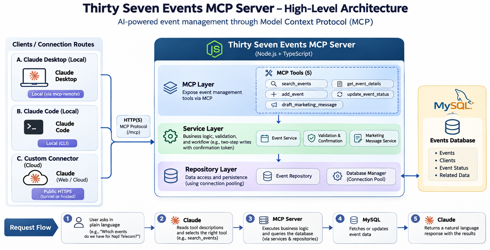

# Connecting the MCP server to Claude

A step-by-step guide to connecting the Thirty Seven Events MCP server to Claude, trying every tool, and checking the results.



---

## 1. How it works

- **Claude is the AI.** It runs in the Claude app, under your own Claude account. This project contains **no AI and needs no AI key**.
- **The MCP server is plain code.** It publishes five tools and runs them against MySQL.
- **Claude chooses the tool.** You type normal English. Claude reads the tools' descriptions, picks one (for example `search_events`), fills in the inputs (`client: "Najd Telecom"`), and the server does the work.
- **Writes need your "yes".** `add_event` and `update_event_status` work in two steps. The first call saves nothing and returns a summary and a one-time token. Only after you confirm does Claude call again with the token, and then the server saves.

| You say                                                       | Tool Claude calls         |
| ------------------------------------------------------------- | ------------------------- |
| "Which events do we have for Najd Telecom?"                   | `search_events`           |
| "Give me full details of event 8."                            | `get_event_details`       |
| "Create an event called …"                                    | `add_event`               |
| "Mark event 10 as in progress."                               | `update_event_status`     |
| "Write an Instagram post for event 10 in English and Arabic." | `draft_marketing_message` |

There are **no special keywords**: ask in plain language. The tool names above are what Claude calls behind the scenes.

## 2. Pick your route

| Route                          | Where the connection starts | Needs                                                    | Good for                                                                                 |
| ------------------------------ | --------------------------- | -------------------------------------------------------- | ---------------------------------------------------------------------------------------- |
| **A. Claude Desktop, local**   | Your Mac                    | A small config entry (`mcp-remote`)                      | Everyday use and demos. Safest: nothing leaves your computer.                            |
| **B. Claude Code, local**      | Your Mac                    | One command                                              | Developers already using Claude Code.                                                    |
| **C. Custom connector, cloud** | **Anthropic's servers**     | A public **HTTPS** address (a tunnel or a hosted server) | Claude on the web, or demos away from your Mac. Temporary only: the server has no login. |

> **Important:** Claude's _custom connector_ dialog rejects local addresses. If you type `http://localhost:3001` it answers: _"Claude connects from Anthropic's servers, so it can't reach a local address like this one. Enter a public https:// URL."_ Use Route A or B for local, or Route C with a tunnel.

## 3. Before you connect

1. MySQL is running and the database is set up: `npm run db:migrate` then `npm run db:seed` (see the main README).
2. Start the MCP server and leave the terminal open:
   ```bash
   npm run dev              # the MCP server, on port 3001
   ```
   You should see `MCP server listening on 127.0.0.1:3001`.
3. Check it answers (second terminal):
   ```bash
   curl -s -X POST http://127.0.0.1:3001/mcp \
     -H 'content-type: application/json' -H 'accept: application/json, text/event-stream' \
     -d '{"jsonrpc":"2.0","id":1,"method":"initialize","params":{"protocolVersion":"2025-06-18","capabilities":{},"clientInfo":{"name":"curl","version":"1"}}}'
   ```
   A line of JSON containing `"serverInfo":{"name":"thirty-seven-events"` means the server is healthy.
4. Your `.env` must have `MCP_PATH=/mcp` for Routes A and B.

## 4. Route A: Claude Desktop (local)

`claude_desktop_config.json` only accepts local commands, so a small bridge, `mcp-remote`, turns the HTTP address into a local one.

1. In Claude Desktop open **Settings → Developer → Edit Config**. (The file is usually `~/Library/Application Support/Claude/claude_desktop_config.json` on macOS and `%APPDATA%\Claude\claude_desktop_config.json` on Windows.)
2. Add:
   ```json
   {
     "mcpServers": {
       "thirty-seven-events": {
         "command": "npx",
         "args": ["-y", "mcp-remote", "http://127.0.0.1:3001/mcp"]
       }
     }
   }
   ```
3. Quit Claude Desktop completely (Cmd+Q) and reopen it.
4. Open **Customize → Connectors**. `thirty-seven-events` should be listed with type **Desktop**, a **Local dev** badge and a check mark.
5. Start a **new chat**, make sure the connector is switched on for it (the **+** in the message box), and ask: _Which events do we have for Najd Telecom?_ Allow the tool when Claude asks.

Notes:

- If Claude Desktop cannot start `npx` (common when Node was installed with `nvm`, because desktop apps do not see your shell's `PATH`), run `which npx` in Terminal and use that full path as `"command"`.
- `mcp-remote` normally accepts `http://127.0.0.1` as is. If it refuses a plain-`http` address on another machine, add `"--allow-http"` to `args`.
- If you have also added a cloud connector for the same server, remove one of them. Claude will otherwise try both ("Used 2 integrations").

## 5. Route B: Claude Code (local)

```bash
claude mcp add --transport http thirty-seven-events http://localhost:3001/mcp
claude mcp list
```

In a Claude Code session type `/mcp` to see it listed. (This command comes from Anthropic's documentation; it was not run while building this project.)

## 6. Route C: cloud custom connector through a tunnel (temporary demo)

Use this only for a short demo. **The server has no login, so anyone who has the address can use it.**

**1. Start a tunnel** (Cloudflare's quick tunnel needs no account):

```bash
brew install cloudflared
cloudflared tunnel --url http://localhost:3001
```

It prints an address such as `https://random-words.trycloudflare.com`. Keep this terminal open. The address changes every time you restart the tunnel.

**2. Tell the server about that hostname.** Edit `.env`. Each setting goes on **its own line**, as `NAME=value`:

```
MCP_ALLOWED_HOSTS=random-words.trycloudflare.com
MCP_PATH=/mcp/k7f29xq4m1
```

- Use the hostname only: no `https://` and no path.
- `MCP_PATH` can be any random letters and digits after `/mcp/`. It acts as a secret part of the address.
- **Never paste a whole command into `.env`.** A line such as `MCP_ALLOWED_HOSTS=… npm run dev` makes the server read garbage as the hostname.

**3. Restart the server** (Ctrl+C, then `npm run dev`). It reads `.env` only at startup. Do not stop the tunnel.

**4. Test it from outside:**

```bash
curl -s -X POST https://random-words.trycloudflare.com/mcp/k7f29xq4m1 \
  -H 'content-type: application/json' -H 'accept: application/json, text/event-stream' \
  -d '{"jsonrpc":"2.0","id":1,"method":"initialize","params":{"protocolVersion":"2025-06-18","capabilities":{},"clientInfo":{"name":"curl","version":"1"}}}'
```

Expect JSON containing `"serverInfo":{"name":"thirty-seven-events"`.

**5. Add the connector** in Claude: **Customize → Connectors → Add → Add custom connector**.

- Name: anything, for example `37 EVENTS`.
- URL: the **full** address including the path, `https://random-words.trycloudflare.com/mcp/k7f29xq4m1`.
- Claude checks the server. It should detect **No sign-in**. Leave **Request headers** empty. Click **Add**.

**6. Use it:** new chat, switch the connector on from the **+** menu, and ask a question.

**7. When you are finished:** press Ctrl+C in the tunnel terminal, then set `.env` back to `MCP_PATH=/mcp` and an empty `MCP_ALLOWED_HOSTS=`, and remove the connector.

(A free Claude plan allows only one custom connector.)

## 7. Try everything: demo prompts

Run `npm run db:reset` first for a known starting point. Type each prompt in a **new chat** with the connector on, and allow each tool when asked. Results below use the seed data.

| #   | Say this                                                                                                                | Tool                      | Expected                                                                     |
| --- | ----------------------------------------------------------------------------------------------------------------------- | ------------------------- | ---------------------------------------------------------------------------- |
| 1   | `Which events do we have for Najd Telecom?`                                                                             | `search_events`           | #1 and #10                                                                   |
| 2   | `Show me all cancelled events.`                                                                                         | `search_events`           | #4 and #7                                                                    |
| 3   | `What events are happening on 4 December 2026?`                                                                         | `search_events`           | #10 only                                                                     |
| 4   | `List events between 1 November and 31 December 2026.`                                                                  | `search_events`           | #8, #9, #10, #11                                                             |
| 5   | `Show planned events for Najd Telecom.`                                                                                 | `search_events`           | #10 only (filters combine)                                                   |
| 6   | `Give me full details of event 8.`                                                                                      | `get_event_details`       | Dammam Healthcare Innovation Summit, SAR 560,000, in progress, 5 projects    |
| 7   | `Create an event called Saudi Tech Expo on 10 May 2027 for Kingdom Fintech Council, budget 310,500.50 SAR, 3 projects.` | `add_event` (step 1)      | A summary and **"Would you like me to proceed?"**. **Nothing is saved yet.** |
| 8   | _(check now, see section 8)_                                                                                            |                           | The event does not exist yet                                                 |
| 9   | `Yes, go ahead.` (within 5 minutes)                                                                                     | `add_event` (step 2)      | Created, with a new id                                                       |
| 10  | `Mark the Saudi Tech Expo event as in progress.`                                                                        | `update_event_status`     | Summary "PLANNED → IN_PROGRESS" and a question                               |
| 11  | `Yes.`                                                                                                                  | `update_event_status`     | Now in progress                                                              |
| 12  | `Set it to in progress.`                                                                                                | `update_event_status`     | Refused: it already has that status                                          |
| 13  | `Mark event 999 as completed.`                                                                                          | `update_event_status`     | Event not found                                                              |
| 14  | `Create an event called Dummy Expo on 1 June 2027 for Najd Telecom, budget 1000.` then `No, cancel that.`               | `add_event`               | Nothing saved                                                                |
| 15  | `Write an Instagram post for event 10 in English and Arabic.`                                                           | `draft_marketing_message` | Two drafts; the budget is never mentioned                                    |
| 16  | `Write a marketing email in Arabic for event 10.`                                                                       | `draft_marketing_message` | Arabic subject and body, Gregorian date                                      |
| 17  | `Write an Instagram post for event 1.`                                                                                  | `draft_marketing_message` | A thank-you post (the event is completed)                                    |
| 18  | `Write an Instagram post for event 4.`                                                                                  | `draft_marketing_message` | Refused: the event is cancelled                                              |

Tips:

- **Answer confirmation questions with a plain "yes" or "no".** A one-word reply such as "Completed" may be read as consent.
- A confirmation expires after 5 minutes and works once. If it expires, just ask again.
- Only the **status** of an event can be changed. Claude will say it cannot edit names, dates, clients or budgets.

## 8. Check the results without trusting Claude

**MySQL** is the source of truth:

```bash
mysql -u <user> -p thirty_seven_events -e "SELECT id,event_name,status FROM events ORDER BY id DESC LIMIT 3"
```

- After prompt 7 (before "yes"): the new event is **not** there.
- After prompt 9: it is there, exactly once.
- After prompt 11: its `status` is `IN_PROGRESS`.

**A different MCP client.** The official MCP Inspector talks to the same server without Claude:

```bash
npx @modelcontextprotocol/inspector --cli http://127.0.0.1:3001/mcp --transport http --method tools/list

npx @modelcontextprotocol/inspector --cli http://127.0.0.1:3001/mcp --transport http \
  --method tools/call --tool-name search_events --tool-arg client=Kingdom
```

**A check that does not depend on the AI.** Try to create an event with a made-up confirmation token:

```bash
npx @modelcontextprotocol/inspector --cli http://127.0.0.1:3001/mcp --transport http \
  --method tools/call --tool-name add_event \
  --tool-arg event_name="Hack Expo" --tool-arg event_date=2027-06-01 \
  --tool-arg client=Test --tool-arg budget=1 --tool-arg confirmation_token=made-up
```

The result is an error with code `CONFIRMATION_TOKEN_INVALID`, and nothing is created. Confirmation is enforced by the server whatever the AI does.

**The demo script** walks through all five tools and the confirmation rule, with you answering yes or no:

```bash
npm run demo
```

(It creates one event for "Demo Client Ltd"; `npm run db:reset` removes it.)
